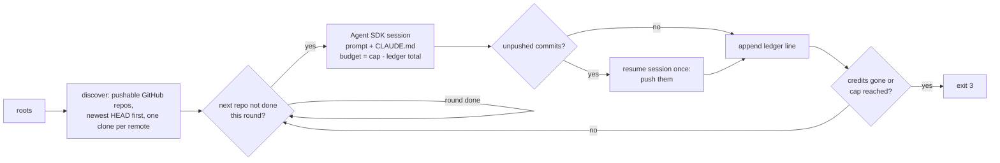

# claude-agent-sdk-audit-loop

Runs one [Claude Agent SDK](https://code.claude.com/docs/en/agent-sdk/overview) session per Git repository under folders you choose, one repository at a time, and starts over when it reaches the end. It stops when your API credits run out or a dollar cap is reached. Every session gets the same prompt. The bundled prompt asks the agent to fact-check every claim in the repository, fix what is wrong, add sources, and push its fixes to GitHub.

**Why:** use a block of API credits (for example, free credits about to expire) on independent audits of all your repositories, without running each one by hand.

**How it works:**
- **Same harness as Claude Code.** Each session is the full Claude Code agent: the `claude_code` system-prompt preset, your `~/.claude/CLAUDE.md` and settings, and all built-in tools, including WebSearch and WebFetch.
- **Unattended.** Permissions are bypassed and there is no turn limit, so a session runs without stopping for approval.
- **Model.** The default is `claude-opus-5-5` at effort `xhigh`.
- **Logging and accounting.** The full transcript streams to your terminal and a log file as it happens. A shared JSONL ledger tracks spend, so a restarted run continues where it stopped.

## Data flow



## Install

You need [uv](https://docs.astral.sh/uv/), git, and optionally the [GitHub CLI](https://cli.github.com/). `gh` is used to skip repositories you cannot push to. The `claude-agent-sdk` wheel bundles the Claude Code CLI, so nothing else is needed.

```bash
uv tool install git+https://github.com/BurnyCoder/claude-agent-sdk-audit-loop
```

To work on the code instead, clone the repository, then run `uv sync` and `uv run pytest`.

## Use it on your own folders

1. Copy `.env.example` to `.env` and set `ANTHROPIC_API_KEY` and `AUDIT_ROOTS`. Each root is a folder whose immediate subfolders are your projects. Optionally set `AUDIT_EXCLUDE` (folder names to skip) and `AUDIT_MAX_TOTAL_USD`. If your key is not scoped to a workspace, also set `ANTHROPIC_WORKSPACE_ID`; the tool sends it as the `anthropic-workspace-id` header through `ANTHROPIC_CUSTOM_HEADERS`.
2. See what would be audited. This costs nothing:
   ```bash
   audit-loop list
   ```
3. Run the preflight check. It costs a few cents and verifies that the key works, the model is right, the API key (not a subscription login) is in use, and the model quotes your `CLAUDE.md`'s first heading:
   ```bash
   audit-loop check
   ```
4. Start the loop:
   ```bash
   audit-loop run
   ```
5. Write the ledger as a Markdown table, optionally committing and pushing it:
   ```bash
   audit-loop report --push
   ```

All settings also work as flags: `--root` (repeatable), `--exclude`, `--env-file` (repeatable; later files win), `--ledger`, `--log-dir`, `--prompt-file`, `--model`, `--effort`, `--max-total-usd` and `--session-timeout-min`. Flags beat `AUDIT_*` environment variables, which beat env files. From env files only `ANTHROPIC_API_KEY`, `ANTHROPIC_WORKSPACE_ID` and `AUDIT_*` are read; other secrets in the same file never reach the agent.

### Several environments, one budget (e.g. Windows + WSL)

`chain` runs commands in order, repeats the list, and stops when one of them exits 3 (credits or cap) or 4 (authentication). Point every step at the same ledger so the cap covers all of them. For example, Windows repos first, then the WSL ones, then again:

```bash
audit-loop chain "audit-loop run --rounds 1" "wsl.exe -d Ubuntu -- bash -lc 'cd <this folder as seen from WSL> && audit-loop run --rounds 1 --root ~/projects'"
```

Commands are split POSIX-style, so quote with `'...'` and use forward slashes.

## What each piece does

| Module | Role |
|---|---|
| `config.py` | Merges flags, `AUDIT_*` and env files. Removes inherited `ANTHROPIC_*`/`CLAUDE*` variables, such as the ones a desktop app exports, so the bundled CLI uses only your key. `--keep-env` turns this off. |
| `discover.py` | Finds subfolders with `.git`, a GitHub `origin`, at least one tracked file, and push access (`gh api repos/o/r` → `permissions.push`). Skips excluded names. Keeps one clone per remote. |
| `session.py` | Builds `ClaudeAgentOptions` and streams every message to the log. Classifies the outcome (`ok`, `billing_exhausted`, `budget_cap`, `auth_failed`, `transient`, `timeout`, `error`). Also runs the push check and the preflight. |
| `ledger.py` | Appends one JSON line per session. Provides the shared spend total, round resume and the report. |
| `cli.py` | Implements `list`, `check`, `run`, `report` and `chain`, plus backoff (1 → 10 minutes) after failures. |

Session options, all documented in the [Python SDK reference](https://code.claude.com/docs/en/agent-sdk/python):

| Option | Value | Why |
|---|---|---|
| `system_prompt` | `{"type": "preset", "preset": "claude_code"}` | Without it the SDK uses a minimal prompt ([docs](https://code.claude.com/docs/en/agent-sdk/modifying-system-prompts)) |
| `setting_sources` | `None` (user, project, local) | Loads `~/.claude/CLAUDE.md`, your settings and the project's `CLAUDE.md` |
| `permission_mode` + `can_use_tool` | `bypassPermissions` + allow-all callback | Unattended; the callback also approves `ask` rules from your settings. Your `deny` rules still apply |
| `model`, `effort`, `thinking` | `claude-opus-5-5`, `xhigh`, adaptive with summaries | Thinking summaries appear in the transcript |
| `max_budget_usd` | cap minus ledger total | Enforces only the shared cap; there is no per-repository limit |

## Stop conditions

The only normal stops are:
- The API reports that the credit balance is exhausted.
- The ledger total reaches `AUDIT_MAX_TOTAL_USD`. The last session gets exactly the remainder as its budget.

Everything else continues:
- **Rate limits, 5xx errors and other failures** back off and move on to the next repository.
- **Authentication failures** stop the loop after three attempts.
- **A finished round** starts a new one, so every repository is audited again, independently.
- **A wall-clock guard** (`AUDIT_SESSION_TIMEOUT_MIN`, default 240) ends a stuck session.

The SDK's cost figures are client-side estimates, not billing statements; compare them with the Console's usage page.

## Safety notes

- The agent runs with full permissions in your repositories and your shell. It can commit, push, open and merge PRs, and install packages, as your `CLAUDE.md` tells it to. Run it only on repositories you are happy to have changed.
- The bundled prompt tells the agent to commit only its own changes and to leave changes that were already uncommitted alone.
- `logs/` and `runs/` are gitignored, because full transcripts can contain secrets printed by tools. Only the `report` table, which lists folder names and GitHub slugs and no local paths, is meant to be committed.
